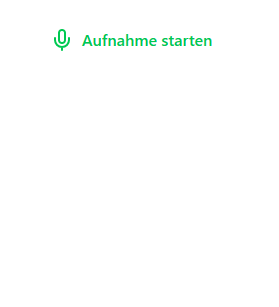
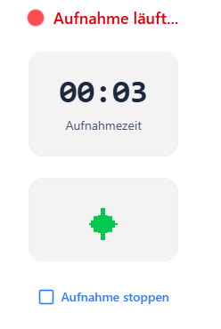
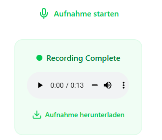

# Audio Recorder (Nuxt Module)


[](https://www.npmjs.com/package/@dcc-bs/audio-recorder.bs.js)

Audio Recorder is a powerful Nuxt.js module that provides advanced audio recording, processing, and management capabilities for web applications. This module includes Vue components, composables, and utilities for seamless audio recording integration with client-side storage and audio format conversion.

<div align="center">
  
  
  
</div>

## Features

- **Audio Recording**: Web-based audio recording with AudioWorklet and PCM capture
- **Audio Visualization**: Real-time audio visualization during recording
- **Session Management**: Persistent audio session storage with IndexedDB
- **Audio Conversion**: FFmpeg integration for PCM to MP3 conversion and concatenation
- **Chunked Recording**: Configurable chunk intervals for efficient storage management
- **Storage Services**: Client-side audio chunk storage with ArrayBuffer for optimal performance
- **Session Explorer**: Browse and manage recorded audio sessions
- **Pause & Resume**: Pause a recording and continue it later, even after the app was closed, crashed or killed by the system
- **Abandoned Recording Recovery**: Automatic detection and recovery of interrupted recordings, which can also be continued
- **iOS Support**: Improved background recording support for iOS devices
- **Internationalization**: Built-in i18n support (English and German)

## Technology Stack

- **Framework**: [Nuxt.js](https://nuxt.com/) module with Vue 3
- **Package Manager**: [Bun](https://bun.sh/)
- **Audio Processing**: [FFmpeg](https://github.com/ffmpegwasm/ffmpeg.wasm) WebAssembly
- **Database**: [Dexie](https://dexie.org/) for IndexedDB management
- **Animation**: [Motion-V](https://motion-v.netlify.app/) for smooth UI transitions
- **Testing**: Playwright for e2e testing

## Setup

### Prerequisites

- Node.js 18+
- Bun package manager
- Modern browser with MediaRecorder API support

### Installation

Install the module to your Nuxt application:

#### Using Bun

```bash
bun add @dcc-bs/audio-recorder.bs.js
```

#### Using NPM

```bash
npm i @dcc-bs/audio-recorder.bs.js
```

#### Using Yarn

```bash
yarn add @dcc-bs/audio-recorder.bs.js
```

### Configuration

Add it to your `nuxt.config.ts`:

```ts
export default defineNuxtConfig({
    modules: ["@dcc-bs/audio-recorder.bs.js"],
});
```

under the vite config in `nuxt.config.ts` configure dexie:
```ts
vite: {
    resolve: {
        alias: {
            dexie: "dexie/dist/dexie.mjs",
        },
    },
}
```

add the following line to your main CSS file:
```css
@import "@dcc-bs/audio-recorder.bs.js";
```

## Client-Only Rendering

All components in this module use the `.client.vue` suffix, which means Nuxt automatically renders them only on the client side. This is required because audio recording relies on browser APIs (MediaRecorder, AudioContext, IndexedDB) that are not available during server-side rendering.

Alternatively, you can also wrap any component with the [`<ClientOnly>` component](https://nuxt.com/docs/4.x/api/components/client-only):

```vue
<template>
  <ClientOnly>
    <AudioRecorder />
  </ClientOnly>
</template>
```

See the [Nuxt client-only pages documentation](https://nuxt.com/docs/4.x/directory-structure/app/pages#client-only-pages) for more details on how Nuxt handles client-only rendering.

## Usage

### Basic Audio Recording

```vue
<template>
  <div>
    <AudioRecorder 
      :show-result="true"
      :auto-start="false"
      :store-to-db-interval="30"
      :logger="customLogger"
      @recording-started="onRecordingStarted"
      @recording-stopped="onRecordingStopped"
    />
  </div>
</template>

<script setup>
function customLogger(message) {
  console.log('[AudioRecorder]:', message)
}

function onRecordingStarted(stream) {
  console.log('Recording started:', stream)
}

function onRecordingStopped(audioBlob, audioUrl) {
  console.log('Recording stopped:', { audioBlob, audioUrl })
}
</script>
```

### Using Audio Recording Composable

#### RecordingOptions

| Property                  | Type                                          | Default    | Description                                                                                                                                                                                          |
| ------------------------- | --------------------------------------------- | ---------- | ---------------------------------------------------------------------------------------------------------------------------------------------------------------------------------------------------- |
| `onRecordingStarted`      | `(stream: MediaStream) => void`               | `() => {}` | Callback when recording starts, providing the MediaStream                                                                                                                                            |
| `onRecordingStopped`      | `(audioBlob: Blob, audioUrl: string) => void` | `() => {}` | Callback when recording stops with the audio data                                                                                                                                                    |
| `onError`                 | `(error: string) => void`                     | `() => {}` | Callback when an error occurs during recording                                                                                                                                                       |
| `storeToDbInterval`       | `number`                                      | `30`       | Interval in seconds to store audio chunks to IndexedDB                                                                                                                                               |
| `onStore`                 | `(mp3Blob: Blob) => void \| Promise<void>`    | `() => {}` | Callback when an MP3 chunk is created during recording (fires every `storeToDbInterval` seconds)                                                                                                     |
| `logger`                  | `(msg: string) => void`                       | `() => {}` | Custom logging function for debugging                                                                                                                                                                |
| `disableDefaultStore`     | `boolean`                                     | `false`    | Disable the default IndexedDB storage. Useful when you want to handle storage yourself via the `onStore` callback                                                                                    |
| `getStream`               | `() => Promise<MediaStream>`                  | microphone | Supplies the stream to record instead of the microphone, e.g. microphone mixed with screen audio for meetings. Called on every start. The recorder never stops this stream's tracks; the caller does |
| `onRecordingPaused`       | `(interrupted: boolean) => void`              | `() => {}` | Callback once a pause is stored. `interrupted` is true when the system (a call, Siri) caused it                                                                                                      |
| `onRecordingResumed`      | `() => void`                                  | `() => {}` | Callback when a paused recording continues                                                                                                                                                           |
| `pauseMode`               | `"auto" \| "release" \| "keep"`               | `"auto"`   | What a pause does with the devices, see [Pause and resume](#pause-and-resume)                                                                                                                        |
| `autoPauseOnInterruption` | `boolean`                                     | iOS only   | Pause instead of recording silence when the system takes the microphone away (phone call, Siri)                                                                                                      |
| `sessionSource`           | `string`                                      | –          | Free-form tag stored with the session, e.g. to tell which recorder should resume it                                                                                                                  |

`onRecordingStarted` fires whenever recording starts on fresh devices: on start, on `resumeSession`, and on a resume that had to reopen the devices.

#### Pause and resume

`pauseRecording()` encodes and stores everything recorded so far, then marks the session as `paused` in IndexedDB. `isSavingPause` is true until that is done; after that a paused recording survives a reload, a closed tab or the system killing the app, and `isBusy` is false. `resumeRecording()` continues it; `stopRecording()` finishes it like a running recording. If part of the audio could not be stored, `pauseSaveFailed` is set and the session stays listed as interrupted instead of paused.

Surviving a reload needs the default IndexedDB storage: with `disableDefaultStore` a pause only stops capturing, and `resumeSession()` refuses to run. An app that stores audio itself through `onStore` needs its own recovery.

What happens to the devices while paused depends on `pauseMode`:

| Mode      | Devices while paused                                                                                 | Resume                                                                                                                                                                                          | Used by `auto`                                                                                                                   |
| --------- | ---------------------------------------------------------------------------------------------------- | ----------------------------------------------------------------------------------------------------------------------------------------------------------------------------------------------- | -------------------------------------------------------------------------------------------------------------------------------- |
| `release` | Closed: the browser's recording indicator goes off (a `getStream` stream stays the caller's to stop) | Opens the devices again, which may show a permission prompt                                                                                                                                     | Desktop and Android browsers                                                                                                     |
| `keep`    | Kept open, the audio is dropped                                                                      | Instant and without a prompt while the kept devices still work. Devices that stopped working (e.g. a screen share ended during the pause) are opened again, which can prompt or show the picker | iOS (WebKit repeats permission prompts), and any `getStream` recording (asking for a screen share again always shows the picker) |

A stored session that no page is recording is resumable with `resumeSession(sessionId)`: one paused earlier, or one cut off by a crash or a closed tab. New audio is appended to it and `recordingTime` continues from the stored duration. Which page records a session is tracked with the Web Locks API, so other tabs neither list it, resume it nor delete it. Without the Web Locks API (insecure contexts, very old browsers) there is no such coordination: another tab could list or resume a session that is still being recorded.

Stored sessions are still subject to the cleanup of `useAudioSessions` (by default older than 7 days or beyond the 10 newest, see `deleteOldSessionsDaysInterval` and `maxSessionsToKeep`), paused ones included. Raise those limits if paused recordings should be kept longer.

The library allows several stored sessions; whether a new recording may start while one is paused is up to the app. `getPausedRecording()` returns the paused one, if any. `useAudioSessions()` offers the same as `pausedRecording`, plus `isReady` (read at least once), `loadFailed` (the last read failed; `refresh()` retries), `refresh()` and `markAsStopped(id, chunkCount)` for a paused recording that was handed on (e.g. for processing) and should no longer count as paused.

Another tab may continue a session while this one exports it. `exportSession(id)` returns the MP3 together with the number of chunks in it; pass that count to `markAsStopped` or `deleteAbandonedRecording` and they refuse (`SessionChanged`) instead of stopping or deleting audio the export did not include. Both also refuse while another page records the session (`SessionInUse`). The `deleteSession` a custom action receives does this check on its own.

#### Example

```vue
<script setup>
import { useAudioRecording, useAudioSessions } from '@dcc-bs/audio-recorder.bs.js'

const { 
  startRecording, 
  stopRecording, 
  recordingTime,
  isRecording,
  isProcessing,
  audioUrl,
  audioBlob,
  currentSession,
  error,
  wasSuspended,
  resetRecording
} = useAudioRecording({
  storeToDbInterval: 30,
  disableDefaultStore: false,
  logger: console.log,
  onRecordingStarted: (stream) => {
    console.log('Recording started')
  },
  onRecordingStopped: (audioBlob, audioUrl) => {
    console.log('Recording completed')
  },
  onError: (error) => {
    console.error('Recording error:', error)
  },
  onStore: (mp3Blob) => {
    console.log('MP3 chunk stored:', mp3Blob)
  }
})

const { getMp3Blob, abandonedRecording, deleteAbandonedRecording } = useAudioSessions({
  deleteOldSessionsDaysInterval: 7,
  logger: console.log
})

// Start recording
await startRecording()

// Stop recording
await stopRecording()

// Download recorded audio as MP3 from a session
async function downloadAudio(sessionId) {
  const blob = await getMp3Blob(sessionId)
  if (blob) {
    const url = URL.createObjectURL(blob)
    const a = document.createElement('a')
    a.href = url
    a.download = `recording-${Date.now()}.mp3`
    a.click()
    URL.revokeObjectURL(url)
  }
}
</script>
```

### Audio Session Explorer

```vue
<template>
  <AudioSessionExplorer />
</template>
```

## Components

### AudioRecorder

The main recording component with start/stop controls and audio visualization.

#### Props

| Property            | Type                            | Default     | Description                                                                      |
| ------------------- | ------------------------------- | ----------- | -------------------------------------------------------------------------------- |
| `showResult`        | `boolean`                       | `true`      | Whether to show the playback section after recording is complete                 |
| `autoStart`         | `boolean`                       | `false`     | Automatically start recording when the component is mounted                      |
| `storeToDbInterval` | `number`                        | `5`         | Interval in seconds to store audio chunks to IndexedDB (e.g., 30 for 30 seconds) |
| `logger`            | `(msg: string) => void`         | `undefined` | Optional custom logging function for debugging                                   |
| `allowPause`        | `boolean`                       | `true`      | Shows the pause button                                                           |
| `pauseMode`         | `"auto" \| "release" \| "keep"` | `"auto"`    | What a pause does with the devices, see [Pause and resume](#pause-and-resume)    |
| `resumeSessionId`   | `string`                        | `undefined` | A stored session to continue instead of starting a new one                       |
| `sessionSource`     | `string`                        | `undefined` | Free-form tag stored with new sessions                                           |

#### Events

| Event               | Parameters                          | Description                                      |
| ------------------- | ----------------------------------- | ------------------------------------------------ |
| `recording-started` | `stream: MediaStream`               | Emitted when recording starts successfully       |
| `recording-stopped` | `audioBlob: Blob, audioUrl: string` | Emitted when recording stops with the audio data |
| `recording-paused`  | `interrupted: boolean`              | Emitted once a pause is stored                   |
| `recording-resumed` | –                                   | Emitted when a paused recording continues        |

#### Exposed Methods & Properties

The component exposes the following methods and reactive properties via template refs:

| Property/Method          | Type                            | Description                                                                                                                                    |
| ------------------------ | ------------------------------- | ---------------------------------------------------------------------------------------------------------------------------------------------- |
| `isRecording`            | `Ref<boolean>`                  | Reactive boolean indicating if recording is in progress                                                                                        |
| `isStarting`             | `Ref<boolean>`                  | True while the recording starts (devices, permission prompt)                                                                                   |
| `isProcessing`           | `Ref<boolean>`                  | True while a stopped recording is being finished                                                                                               |
| `isBusy`                 | `ComputedRef<boolean>`          | Starting, recording, finishing or storing a pause: audio would be lost if the page went away. Use it to guard navigation or keep a dialog open |
| `isActive`               | `ComputedRef<boolean>`          | Holds a session: starting, recording, paused or finishing. A new start is ignored while true |
| `startRecording`         | `() => Promise<void>`           | Method to start audio recording                                                                                                                |
| `isPaused`               | `Ref<boolean>`                  | True while the recording is paused                                                                                                             |
| `isSavingPause`          | `Ref<boolean>`                  | True while a pause is still being stored                                                                                                       |
| `wasInterrupted`         | `Ref<boolean>`                  | The current pause was caused by the system (call, Siri)                                                                                        |
| `pauseRecording`         | `() => Promise<void>`           | Pauses and stores everything recorded so far                                                                                                   |
| `resumeRecording`        | `() => Promise<void>`           | Continues a paused recording                                                                                                                   |
| `resumeSession`          | `(id: string) => Promise<void>` | Continues a stored (paused or interrupted) session                                                                                             |
| `stopRecording`          | `() => Promise<void>`           | Stops the recording. Cancels a start still in progress, does nothing without a recording, and joins a stop already in progress                 |
| `recordingTime`          | `Ref<number>`                   | Recording time in seconds                                                                                                                      |
| `formattedRecordingTime` | `ComputedRef<string>`           | Formatted recording time as "MM:SS"                                                                                                            |
| `error`                  | `Ref<string \| null>`           | Current error message, if any                                                                                                                  |
| `audioUrl`               | `Ref<string \| null>`           | URL of the recorded audio blob                                                                                                                 |

#### Usage with Template Ref

```vue
<script setup lang="ts">
import { ref, computed } from 'vue';
import type { AudioRecorder } from '#components';

const recorderRef = ref<typeof AudioRecorder>()

const isRecording = computed(() => recorderRef.value?.isRecording)
const formattedTime = computed(() => recorderRef.value?.formattedRecordingTime)

function startRecording() {
  recorderRef.value?.startRecording()
}

function stopRecording() {
  recorderRef.value?.stopRecording()
}
</script>

<template>
  <div>
    <AudioRecorder ref="recorderRef" />
    <button @click="startRecording">Start</button>
    <button @click="stopRecording">Stop</button>
    <p>Recording: {{ isRecording }}</p>
    <p>Time: {{ formattedTime }}</p>
  </div>
</template>
```

### AudioVisualizer

Real-time audio waveform visualization component that displays frequency data as animated bars.

#### Props

| Property      | Type                       | Required | Description                                                            |
| ------------- | -------------------------- | -------- | ---------------------------------------------------------------------- |
| `stream`      | `MediaStream \| undefined` | Yes      | The audio stream to visualize                                          |
| `isRecording` | `boolean`                  | Yes      | Whether recording is currently active (controls visualization updates) |

#### Events

This component does not emit any events.

#### Exposed Methods & Properties

This component does not expose any methods or properties via `defineExpose`.

#### Usage

```vue
<script setup lang="ts">
import { ref } from 'vue'

const audioStream = ref<MediaStream>()
const recordingState = ref(false)

// Get stream from getUserMedia or other source
navigator.mediaDevices.getUserMedia({ audio: true })
  .then(stream => {
    audioStream.value = stream
    recordingState.value = true
  })
</script>

<template>
  <div>
    <AudioVisualizer 
      :stream="audioStream" 
      :is-recording="recordingState" 
    />
  </div>
</template>
```

#### Technical Details

- Uses Web Audio API with `AudioContext` and `AnalyserNode`
- FFT size: 256 for frequency analysis
- Updates visualization every 50ms when recording
- Displays 25 frequency bars (mirrored for visual symmetry)
- Automatically cleans up audio context when recording stops
- Responsive design with bars scaling based on frequency amplitude

### AudioSessionExplorer

Browse and manage audio sessions component with customizable actions.

#### Props

| Property             | Type             | Default | Description                                                          |
| -------------------- | ---------------- | ------- | -------------------------------------------------------------------- |
| `showDownloadButton` | `boolean`        | `true`  | Whether to show the default download button                          |
| `showDeleteButton`   | `boolean`        | `true`  | Whether to show the default delete button                            |
| `customActions`      | `CustomAction[]` | `[]`    | Array of custom action buttons to display before the download button |

#### CustomAction Interface

```typescript
interface CustomAction {
    label: string; // Button text
    icon?: string; // Icon name (e.g., 'i-lucide-upload')
    color?: string; // Button color (default: 'primary')
    variant?: string; // Button variant (default: 'soft')
    loading?: boolean; // External loading state
    disabled?: boolean; // External disabled state
    needsAudio?: boolean; // false: skip joining the MP3, the handler gets an empty Blob (default: true)
    visible?: (session: AudioSession) => boolean; // show the action only for some sessions
    handler: (
        sessionId: string,
        mp3Blob: Blob,
        deleteSession: () => Promise<void>, // rejects if the session got new audio meanwhile or is being recorded
        chunkCount?: number, // chunks in mp3Blob, e.g. for markAsStopped
    ) => void | Promise<void>;
}
```

#### Slots

| Slot      | Props                                    | Description                                        |
| --------- | ---------------------------------------- | -------------------------------------------------- |
| `actions` | `session`, `getMp3Blob`, `deleteSession` | Custom action buttons slot for maximum flexibility |

The explorer emits `deleted` (`sessionId`) after a session was deleted, by its Delete button or by a custom action's `deleteSession`.

#### Usage Examples

**Basic usage:**
```vue
<template>
  <AudioSessionExplorer />
</template>
```

**With custom actions:**
```vue
<script setup lang="ts">
import type { CustomAction } from '@dcc-bs/audio-recorder.bs.js'

const customActions: CustomAction[] = [
  {
    label: 'Upload',
    icon: 'i-lucide-upload',
    color: 'blue',
    handler: async (sessionId, mp3Blob, deleteSession) => {
      // Upload the blob to your server
      await uploadToServer(mp3Blob)
      
      // Optionally delete the session after successful upload
      await deleteSession()
    }
  },
  {
    label: 'Share',
    icon: 'i-lucide-share',
    color: 'green',
    variant: 'outline',
    handler: async (sessionId, mp3Blob) => {
      // Share the audio blob
      await shareAudio(mp3Blob)
      // Session is kept (no deleteSession call)
    }
  }
]
</script>

<template>
  <AudioSessionExplorer :custom-actions="customActions" />
</template>
```

**Hide default buttons and use custom actions only:**
```vue
<script setup>
const customActions = [
  {
    label: 'Process',
    icon: 'i-lucide-cog',
    handler: async (sessionId, mp3Blob, deleteSession) => {
      const processed = await processAudio(mp3Blob)
      if (processed) {
        await deleteSession()
      }
    }
  }
]
</script>

<template>
  <AudioSessionExplorer
    :custom-actions="customActions"
    :show-download-button="false"
    :show-delete-button="false"
  />
</template>
```

**Using the actions slot for maximum control:**
```vue
<template>
  <AudioSessionExplorer>
    <template #actions="{ session, getMp3Blob, deleteSession }">
      <UButton
        @click="async () => {
          const blob = await getMp3Blob()
          await customProcessing(blob, session.id)
        }"
        color="purple"
        icon="i-lucide-sparkles"
      >
        Custom Action
      </UButton>
    </template>
  </AudioSessionExplorer>
</template>
```

**Combining custom actions with slot:**
```vue
<script setup>
const customActions = [
  {
    label: 'Quick Upload',
    icon: 'i-lucide-upload',
    handler: async (sessionId, mp3Blob, deleteSession) => {
      await quickUpload(mp3Blob)
      await deleteSession()
    }
  }
]
</script>

<template>
  <AudioSessionExplorer :custom-actions="customActions">
    <template #actions="{ session, getMp3Blob }">
      <!-- Additional custom button via slot -->
      <UButton @click="specialAction(session)">
        Special
      </UButton>
    </template>
  </AudioSessionExplorer>
</template>
```

#### Features

- **Session List**: Displays all recorded audio sessions with metadata
- **Download**: Export sessions as MP3 files (can be disabled)
- **Delete**: Remove sessions from storage (can be disabled)
- **Custom Actions**: Add custom buttons with access to the MP3 blob and delete functionality
- **Loading States**: Automatic loading indicators for all actions
- **Animations**: Smooth transitions using Motion-V
- **Empty State**: User-friendly message when no sessions exist

## Development

Start the development playground:

```bash
bun dev
```

Build the module:

```bash
bun dev:build
```

Prepare the development environment:

```bash
bun dev:prepare
```

## Testing

Run unit tests:

```bash
bun test
```

Run tests with coverage:

```bash
bun test:coverage
```

Run end-to-end tests:

```bash
bun test:e2e
```

Run tests in watch mode:

```bash
bun test:watch
```

## Code Quality

Format code with Biome:

```bash
bun lint
```

Run linting and fixes:

```bash
bun check
```

## Architecture

### Recording Pipeline

The module uses a modern AudioWorklet-based architecture for high-quality PCM audio capture:

1. **AudioWorklet PCM Capture**: Raw PCM audio data is captured using a custom AudioWorkletProcessor (`pcm-recorder-worklet.js`)
2. **Chunked Storage**: PCM data is accumulated in memory and periodically converted to MP3 chunks using FFmpeg.wasm
3. **IndexedDB Persistence**: MP3 chunks are stored as ArrayBuffers in IndexedDB for efficient storage
4. **Final Concatenation**: On recording completion, all MP3 chunks are concatenated into a single MP3 file

This architecture provides:
- **Lower memory footprint** compared to MediaRecorder blob accumulation
- **Better iOS compatibility** with AudioWorklet support
- **Flexible chunk intervals** for customizable storage patterns
- **Direct MP3 output** without intermediate WebM files

### Database Schema

**AudioSession**: Tracks recording metadata
- `id`, `name`, `createdAt`, `chunkCount`, `totalSize`
- `chunkIds`: Array maintaining chunk order
- `sampleRate`, `numChannels`: PCM metadata for reconstruction
- `status`: `recording` (interrupted when no page owns it), `paused` or `stopped` (ended, kept as a backup)
- `duration`: seconds of audio stored, `pausedAt`, `source`

**AudioChunk**: Stores MP3 audio chunks
- `id`, `sessionId`, `createdAt`
- `buffer`: ArrayBuffer containing MP3 data

## Project Structure

- `src/`: Main module source code
  - `module.ts`: Nuxt module entry point
  - `runtime/`: Runtime components and composables
    - `assets/`: AudioWorklet processor files
    - `components/`: Vue components for audio recording
    - `composables/`: Audio recording composables and FFmpeg integration
    - `services/`: Audio storage and database services
    - `utils/`: Utility functions for microphone handling and PCM processing
    - `lang/`: Internationalization files
- `playground/`: Development playground and examples
- `tests/`: Unit and integration tests
  - `e2e/`: End-to-end tests with Playwright
  - `nuxt/`: Nuxt-specific tests

## Release

To release a new version:

```bash
bun release
```

This will run linting, tests, build the module, generate changelog, and push with tags.

## License

[MIT](LICENSE) © Data Competence Center Basel-Stadt

<a href="https://www.bs.ch/schwerpunkte/daten/databs/schwerpunkte/datenwissenschaften-und-ki"></a>

Datenwissenschaften und KI <br>
Developed with ❤️ by DCC - Data Competence Center
